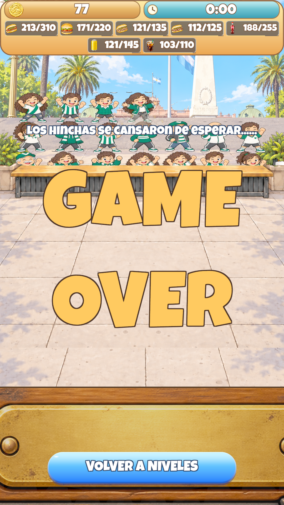
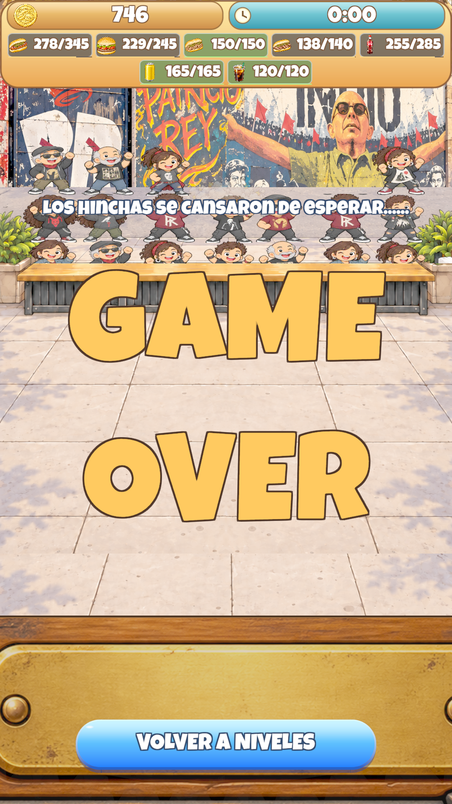

# Informe completo — viabilidad y balance de los 11 niveles
**21 de octubre de 2026 · partidas reales en Unity, ×1 · sin cambios de código ni balance.**

## 1. Conclusión ejecutiva
Se completaron **155 partidas: 5 victorias y 150 derrotas**. Hay además **una partida histórica interrumpida**, excluida de esos resultados y del límite de25. Los niveles ganados se detuvieron en su primera victoria; no se hicieron25 partidas innecesarias allí.

**Los niveles1–5 se pudieron ganar; desde Racing no encontré una estrategia ganadora dentro del límite ensayado.** Esto evidencia un salto de dificultad que merece revisar balance y entrega. **No prueba imposibilidad matemática**, ni que todas las estrategias humanas posibles fallen. No presento una receta ganadora para los niveles que no gané.

La continuación solicitada añadió46 partidas completas:21 de Camioneros y25 de Los Redondos, sin repetir los otros niveles. Ambos alcanzaron25 derrotas acumuladas. Se preserva el informe histórico del corte; este documento lo sustituye como consolidado actualizado.

## 2. Cobertura de todos los niveles
| Nivel | Completas | Victorias | Derrotas | Resultado |
|---|---:|---:|---:|---|
| 1. All Boys / Floresta | 1 | 1 | 0 | Ganado a los 75.13s |
| 2. Nueva Chicago | 1 | 1 | 0 | Ganado a los 107.71s |
| 3. Vélez / Liniers | 1 | 1 | 0 | Ganado a los 122.17s |
| 4. Ferro | 1 | 1 | 0 | Ganado a los 150.80s |
| 5. Independiente | 1 | 1 | 0 | Ganado a los 177.93s |
| 6. Racing | 25 | 0 | 25 | Sin victoria; mejor intento comparativo 4 |
| 7. San Lorenzo | 25 | 0 | 25 | Sin victoria; mejor intento comparativo 22 |
| 8. River | 25 | 0 | 25 | Sin victoria; mejor intento comparativo 1 |
| 9. Boca | 25 | 0 | 25 | Sin victoria; mejor intento comparativo 23 |
| 10. Camioneros | 25 | 0 | 25 | Sin victoria; mejor intento comparativo 21 |
| 11. Los Redondos / Tandil | 25 | 0 | 25 | Sin victoria; mejor intento comparativo 10 |

Racing incluye10 partidas previas +15 de la ampliación. Camioneros incluye4 previas +21 de esta continuación. El antiguo intento5 de Camioneros interrumpido a89,34s no es una derrota: el nuevo intento5 se reinició desdecero y tiene evidencia separada. Cada fila del CSV identifica su fuente.

## 3. Método y límites de la evidencia

- Main del checkout activo /Users/celestino/HayChoriYPaty, Unity 6000.6.3f1, seed normal1337 y reglas serializadas vigentes.
- Partidas en Play Mode a **×1**, avanzadas por StreetGame.Update/Time.deltaTime. No se sustituyeron por simulaciones numéricas, llamadas directas a Step, adelantos del reloj ni cambios de metas o recursos.
- Automatización de acciones normales mediante StreetView.DispatchAction: navegación, selección, contratación, velocidad y compra de faltantes en Mercado. Compras de ronda con intervalo mínimo de0,5 s de juego, sujetas a sus precios y fondos reales.
- Se probaron secuencias fijas, modificaciones posteriores a derrotas y dos heurísticas de compra basadas en el estado observado (mesadas, trabajadoresIdle y costos). **No fue juego manual humano ni una optimización exhaustiva.** Las heurísticas calculan prioridades de compra, no resultados de partidas.
- Perfil **QA local legado y desbloqueado**, no campaña nueva ni dispositivoAndroid. El saldo persistente inicial elevado ya existía; no se agregó dinero. Permitió comprar stock entre niveles por el Mercado normal, pero no pasó a caja de ronda. Por eso esta prueba no valida la solvencia/progresión de una campaña fresca.

- En esta continuación se usaron planes de compras adaptados entre partidas y variaciones basadas en resultados reales; no el resultado de una simulación. Caja inicial oficial:1–5 $0,6–9 $250,10 $500,11 $2000. El banco persistente de QA no es caja de ronda.
- En las46 partidas nuevas hay2881 muestras de estado, todas con escala1; se registraron estados cada~5s, inicio/mitad/final en GameView1080×1920, compras con hora y dinero antes/después, y cola/trabajadores al terminar. La revisión visual es muestral: no video continuo ni inspección humana de todos los fotogramas.
- **Limitación de estrategia descubierta:** una heurística temporal de la auditoría anterior clasificaba Cerveza como Fernetero; el rol correcto es Cocacolero, para Coca y Cerveza. Esto es un error de prioridad de compra del auditor, NO un bug del juego. Las partidas anteriores siguen siendo reales, pero no prueban estrategia óptima. El observador de esta continuación usa la asignación correcta. Tampoco todas las compras previstas se alcanzaron antes del reloj: la traza de compras, no el plan, determina lo ejecutado.
- La pasada anterior también dejó documentados un intento de velocidad10 rechazado sin efecto y un override de Boca16 configurado demasiado tarde que no llegó a ejecutarse. No se cuentan como mejoras compradas ni estrategias probadas.
- La evidencia antigua de victoria numérica con otra seed no acredita victoria real en esta configuración. No se validó Android, campaña nueva, consola limpia ni aceptación humana.

Las155 partidas completas acumularon **12h13min28s de juego real**. La continuación nueva transcurrió aproximadamente entre10:21 y14:23, hora de Buenos Aires.

## 4. Mejor partida real por nivel difícil
Cada fila corresponde a **una sola partida**, no combina máximos de distintas partidas. Orden: Chori / Paty / Bondiola / Vacío / Coca / Fernet / Cerveza. Se elige por menor proporción cubierta de cuota, con desempate .02×promedio de proporciones limitadas a1; es un índice comparativo, no probabilidad ni certificado de optimalidad.

| Nivel / intento | Vendidos | Objetivos | Faltante total | Mesada preparada al final |
|---|---|---|---:|---|
| Racing / 4 | 191,163,92,91,175,76,90 | 210,145,80,75,175,75,90 | 19 | 15,36,1,1,0,0,0 |
| San Lorenzo / 22 | 215,161,109,91,185,80,105 | 230,165,100,85,195,80,105 | 29 | 9,48,1,18,9,0,0 |
| River / 1 | 196,159,110,106,169,92,109 | 250,180,110,95,210,90,115 | 122 | 23,45,1,3,12,0,6 |
| Boca / 23 | 196,174,110,105,187,97,125 | 275,195,120,110,225,100,125 | 156 | 2,22,3,6,12,3,0 |
| Camioneros / 21 | 213,171,121,112,188,103,121 | 310,220,135,125,255,110,145 | 271 | 26,42,3,11,11,8,12 |
| Los Redondos / Tandil / 10 | 278,229,150,138,255,120,165 | 345,245,150,140,285,120,165 | 115 | 21,39,4,15,12,0,0 |

### Qué faltó y con qué equipo terminó
- **Racing:** Chori: 19. Equipo Normal/Cocacolero/Premium/Fernetero/Mozo=6,3,3,2,6; mejoras de velocidad8; caja$9.
- **San Lorenzo:** Chori: 15, Paty: 4, Coca: 10. Equipo Normal/Cocacolero/Premium/Fernetero/Mozo=5,3,3,2,6; mejoras de velocidad8; caja$37.
- **River:** Chori: 54, Paty: 21, Coca: 41, Cerveza: 6. Equipo Normal/Cocacolero/Premium/Fernetero/Mozo=5,3,3,2,5; mejoras de velocidad8; caja$219.
- **Boca:** Chori: 79, Paty: 21, Bondiola: 10, Vacío: 5, Coca: 38, Fernet: 3. Equipo Normal/Cocacolero/Premium/Fernetero/Mozo=6,3,3,2,5; mejoras de velocidad6; caja$659.
- **Camioneros:** Chori: 97, Paty: 49, Bondiola: 14, Vacío: 13, Coca: 67, Fernet: 7, Cerveza: 24. Equipo Normal/Cocacolero/Premium/Fernetero/Mozo=5,3,3,2,5; mejoras de velocidad7; caja$77.
- **Los Redondos / Tandil:** Chori: 67, Paty: 16, Vacío: 2, Coca: 30. Equipo Normal/Cocacolero/Premium/Fernetero/Mozo=5,4,4,2,5; mejoras de velocidad7; caja$746.

## 5. Qué aprendieron las partidas adicionales
- **Camioneros:** el mejor de los25 fue el21. Probar más normales temprano y más servicio no dio mejora monotónica: el6 llegó a157Chori con acumulación de comida, el8 a178, mientras el21 alcanzó213. El25 vendió204Chori pero másPaty/Coca; no se mezclan esos máximos para inventar una partida mejor.
- **Los Redondos:** el primer intento vendió246Chori; adelantar velocidad y mozos elevó el4 a274 y el10 a278. Se ensayaron variantes priorizando servicio, producción normal y velocidad, además de diferir contrataciones premium/fernet tardías. El14 alcanzó6mozos pero no ganó; el18 bajó a210Chori. Más empleados de un rol, por sí solo, no garantiza más ventas ni victoria.
- En Redondos10 la secuencia efectiva fue: Mozo1→Coca1→Premium1→Fernet1→Normal2→Velocidad1→Mozo2→Mozo3→Normal3→Coca2→Premium2→Velocidad2→Normal4→Premium3→Coca3→Velocidad3→Velocidad4→Mozo4→Normal5→Velocidad5→Coca4→Mozo5→Velocidad6→Fernet2→Velocidad7→Premium4. Mozo3 entró a3,56s; Normal4 a14,68s; Mozo4 a112,91s; Normal5 a136,24s; Mozo5 a216,09s. **Es la mejor traza comparativa observada hasta ese punto, no una receta para ganar.** Tras25, esa partida10 siguió siendo la mejor según el índice comparativo.

## 6. Diagnóstico de entrega, cocacoleros y visual

### Hallazgos con evidencia directa
1. **Salto desde nivel 6:** los cinco niveles anteriores se ganaron con44,87–72,29 s de margen; desde Racing las estrategias ensayadas no consiguieron cerrar todas las metas. Coincide con el cambio a cocción física, transporte a mesada y entrega por mozos. Es una asociación observada, no una atribución causal exclusiva.
2. **Chori es el déficit más consistente**, pero no el único. EnRacing7 había másChori preparados que faltantes. EnSan22 habíaPaty48 yVacío18 preparados, mientras aún faltabanChori yCoca. EnRiver1 había23 Chori y45 Paty preparados al cortar. Comprar más cocineros sin revisar entrega no garantiza mejor resultado.
3. **También hubo escasez real de Chori:** Boca 23 terminó con solo2 preparados y79faltantes. EnSan17 llegó a0 preparados. No sería correcto diagnosticar todos los fallos como puro atasco de mozos.
4. **Idle no equivale a congelamiento gráfico:** en el volcado previo de Racing 2, los cocacoleros estabanIdle, había2 Coca y su cliente seguía detrás del mostrador elegible. Assign/IsAtCounter atienden al frente; los pedidos mixtos retrasan el acceso de quienes esperan atrás. El volcado de una partida no prueba idéntico estado en todas.
5. **La asignación y la producción requieren evaluación conjunta:** el código usaFIFO, elegibilidad de primera fila y propiedad de líneas; la cocina normal/premium comparte una secuencia de productos. Las ventas extra de un producto cumplido pueden ser necesarias para vaciar clientes mixtos. No basta prohibirlas sin analizar la cola.

### Lectura visual de las capturas
- Los trabajadores se superponen en circulación y retiros, lo que dificulta distinguir estados y roles. No se demostró que esa superposición gráfica por sí sola bloquee el motor.
- Los globos con puntos suspensivos ocultan líneas de pedidos mixtos: no siempre se ve qué comida retiene a un cliente.
- Falta una razón visible de espera para especialistasIdle; con cuota pendiente y stock preparado puede parecer un bug.
- En el resumen de victoria hay texto de productos sobre la ilustración y una fila deREPOSICIÓN muy próxima/al ras del separador. Es un problema de legibilidad observado, no la causa demostrada de pérdidas.
- Las capturas de derrota se tomaron al entrar en la animación; diferencias transitorias comoGAME blanco frente a dorado no se interpretan como congelamiento.

### Comprobación nueva en Los Redondos
En Redondos10, al terminar, los4cocacoleros estabanIdle mientras los5mozos seguían en estadosToCounter/ToStation. Había21Chori y39Paty preparados; el cliente213, elegible en mostrador, aún debía recibir3Chori, y otros clientes detrás seguían pidiendo bebidas. Esto es compatible con un cuello de entrega/eligibilidad de cola, no con un congelamiento visual demostrado. Cerveza ya había cumplido165/165; Coca seguía255/285. No se puede concluir que todos los Idle sean indebidos sin revisar cada línea y reserva.

La captura de mitad de Redondos10 muestra mesadas cargadas, cruces y superposición de trabajadores; globos con «…» y monedas flotantes ocultan parte de los pedidos. La captura final confirma reloj0 y cuotas incompletas. **Problemas de legibilidad sí; bloqueo causado por el dibujo no demostrado.**

## 7. Agregado: qué mejorar por nivel, sin aplicar cambios
Todas las propuestas siguientes son **experimentos no implementados y no validados**. No aseguran victoria. Primero medir, luego cambiar un factor por vez y volver a jugar ×1.

| Nivel | Mejora propuesta y motivo | Cómo comprobarla |
|---|---|---|
| 1. All Boys | Mantener balance: se ganó con44,87s de margen. Explicar primera contratación y velocidad. | Nuevo jugador debe entender las compras sin guía externa. |
| 2. Chicago | Mantener balance; tutorial breve de Coca y costo de repartir inversión. | Primera partida humana sin confundir cocina con bebidas. |
| 3. Vélez | Mantener balance; mostrar que Normal cubre Chori/Paty y sus cuotas. | Comprensión del reparto mixto y victoria repetible. |
| 4. Ferro | Mantener balance; aclarar Premium=Bondiola/Vacío y Cocacolero=Coca/Cerveza. | No comprar rol equivocado para Cerveza; pedidos completos legibles. |
| 5. Independiente | Mantener balance de entrada; enseñar Fernetero y lectura de siete metas. | Partida humana sin que etiquetas o globos oculten el producto que frena. |
| 6. Racing | Tutorial obligatorio del cambio a cocción física y entrega: se empieza sinMozo. Advertir comida preparada sin servicio. Medir cola/recorridos antes de tocar cuotas. Como ensayo aislado:280s en lugar de255, O Chori190 en lugar de210. | Repetir varias estrategias y ganar con margen; no aplicar ambas variantes juntas ni extrapolar a otros niveles. |
| 7. San Lorenzo | Ajuste fino de entrega/arranque: el mejor faltó15Chori,4Paty y10Coca. Ensayar una variante aislada de tiempo o costo inicial. | Ver que bajen esos déficits sin generar otro producto bloqueante; medir margen y repetibilidad. |
| 8. River | Recalibrar financiación inicial y costo escalonado frente al circuito físico. No parece un pequeño déficit de una sola cuota. | Comparar una sola variante de capital/costo o duración; mantener ventas reales y registrar tiempos de contratación. |
| 9. Boca | Revisar arranque y capacidad de producción/entrega: faltaron79Chori y38Coca en la mejor partida. No basta suponer «comprá otroMozo». | Ensayo independiente de capital inicial o curva de compra; confirmar Chori preparado y entregado, no solo equipo final. |
| 10. Camioneros | Revisar conjuntamente objetivos300s, curva de contratación y rendimiento de traslado. Priorizar diagnóstico de Chori/Coca y cobertura temprana, no más contratación ciega. | Nuevas partidas tras un ajuste aislado deben reducir97Chori y67Coca faltantes de la mejor observada, además de las demás cuotas. |
| 11. Los Redondos | Ya empieza con$2000 y aun así las estrategias fallan: no asumir que dar dinero resuelve todo. Medir bloqueo por comida/cola y costo de servicio/velocidad tardío; después recalibrar cuotas o tiempo. | Probar un cambio por vez, lograr victoria repetible con margen; comparar con la mejor partida completa delCSV. |

### Presupuesto inicial y salto de dificultad
Referencia de compra, **no mínimo matemático para ganar**: añadir Normal2+Coca1+Premium1+Fernet1+Mozo1 cuesta225/250/280/310/340/390 en niveles6–11. Sumando primera velocidad, quedarían -5/-40/-85/-130/+75/+1505 respecto de la caja inicial oficial. Es posible ganar dinero antes de cubrir todos los roles; esta cuenta solamente revela presión de caja y el costo de abrir todas las líneas.

River y Boca no pueden comprar esa cobertura de golpe con$250. Los Redondos sí dispone de mucho margen inicial y tampoco ganó en las estrategias ensayadas: hay que medir la cadena física y los costos sucesivos, no limitar el diagnóstico a «falta plata».

### Prioridades transversales
1. **Observabilidad:** indicar razón deIdle («sin cliente elegible», «pedido detrás», «esperando comida», «reserva ocupada»), antigüedad de líneas y ocupación de mesadas.
2. **Entrega:** medir tiempo cocinar→llevar→depositar→retirar→servir; comida pendiente en mostrador; demora de clientes mixtos. Evaluar prioridades FIFO/propiedad de líneas con evidencias, no cambiar reglas silenciosamente.
3. **Balance:** calibrar cada nivel activo con el circuito físico real. Evitar victoria al últimofotograma o secuencia única sin tolerancia humana. Ajustar un parámetro por prueba y registrar efectos secundarios.
4. **Producción:** revisar excedentesPaty mientras faltaChori. La alternancia fija está contratada; ponderarla por demanda/cuotas sería cambio de diseño que requiere aprobación y contrato actualizado, no supuesto bugfix.
5. **Visual:** separar siluetas/etiquetas de roles, pedidos completos desplegables, motivo de espera y resumen legible. La mejora visual no reemplaza el balance.

Criterio de producto recomendado: varias victorias humanas ×1 en más de un perfil/dispositivo y con margen para reaccionar; no depender del bancoQA ni de compras con precisión automática. **Ese criterio no fue ejecutado ni aprobado aquí.**

## 8. Preservación, alcance y validación
- Se detuvo al ganar o completar25, según el alcance. No se tocaron fuentes productivas, balance ni metas. La automatización fue compilada en memoria; su texto se conserva fuera delcheckout solo como evidencia.
- **PASS preservación:**28 fuentes C# productivas y escenaMain con hashes idénticos; estadoGit exactamente igual antes/después. **PASS restauración:** progreso original comparado exactamente (3439caracteres), Play detenido, escena original limpia, escala0, testInitfalse y backgroundtrue.
- Comparar `production-code-before.sha256`/`production-code-after.sha256` y `main-before.sha256`/`main-after.sha256`. Ver `preservation.txt` y `restoration.txt` (los snapshots completos de Git se conservan en la evidencia local) para el resultado efectivo de preservación/restauración, no inferirlo solo de esta declaración.
- Revisión independiente: `VALIDACION_FINAL.md` en esta misma carpeta. Victoria demostrada1–5; victoria6–11 no demostrada. Android/campaña nueva/aceptación humana:NOT_RUN.
- No huboAPK, instalación, commit, push ni cambios globales. Se preservan cambios locales previos ajenos.

## 9. Anexos y trazabilidad
- **TODAS_LAS_PARTIDAS_COMPLETAS.csv:** todas las partidas terminadas de los11niveles con fuente, intento, fase, ventas, metas, equipo, velocidad y mesada.
- **results.tsv:** resultados nuevos deCam5–25 yRedondos; no reescribe los históricos.
- **state.tsv/purchases.tsv/queue.tsv/workers.tsv por intento:** tiempo, escala, compra legal y estado final.
- **initial.txt/menu.tsv/policy-overrides.tsv:** seed, inventario finito, caja oficial, operaciones del Mercado y planes efectivamente seleccionados.
- **controller.cs.txt:** observador temporal en memoria, no un archivo añadido al juego.
- **live-balance-readonly.tsv:** balance vigente leído de la escena, sin modificar.
- La evidencia previa y capturas1–9, así como las trazas completas de las46 partidas nuevas, se conservan localmente fuera del repositorio. Este paquete contiene el CSV consolidado, resultados nuevos y una selección de trazas/capturas, no los372MB de material completo.

### Capturas representativas nuevas

**Camioneros, intento21:**

**Los Redondos / Tandil, intento10:**

### Compras de las cinco victorias observadas
Son trazas ganadoras concretas de este entorno, no garantías universales. El tiempo se cuenta desde inicio de ronda. N=Normal, C=Coca, P=Premium, F=Fernetero, M=Mozo, V=Velocidad.

**Nivel 1 — All Boys / Floresta:** 3.1 s V (5→0); 8.7 s N (15→0); 10.7 s V (10→0); 17.8 s N (40→0); 19.4 s V (15→0); 28.0 s N (80→5); 29.5 s V (20→0); 32.6 s V (35→5); 42.2 s N (135→0); 45.2 s V (50→5); 57.4 s N (215→5); 60.9 s V (75→10); 64.6 s V (90→0); 70.1 s V (125→0).

**Nivel 2 — Nueva Chicago:** 7.6 s C (20→0); 10.1 s V (10→0); 13.7 s N (25→5); 15.2 s V (15→0); 20.7 s N (50→0); 26.8 s C (50→0); 28.8 s V (25→0); 39.4 s N (105→5); 41.4 s V (35→5); 48.0 s C (100→0); 51.0 s V (45→0); 59.1 s N (195→15); 61.6 s V (70→0); 72.7 s N (280→0); 78.8 s V (105→5); 85.9 s C (185→5); 89.9 s V (140→5); 96.0 s V (215→25).

**Nivel 3 — Vélez / Liniers:** 9.1 s C (25→0); 12.6 s V (15→0); 16.7 s N (25→0); 19.2 s V (25→0); 26.3 s N (65→0); 32.9 s C (65→0); 35.4 s V (50→15); 42.5 s N (130→5); 44.5 s V (45→0); 51.0 s C (130→5); 54.1 s V (75→5); 63.2 s N (225→0); 67.2 s V (105→0); 81.3 s N (360→10); 86.9 s V (160→10); 95.0 s C (230→5); 102.6 s V (205→0); 113.2 s V (290→5).

**Nivel 4 — Ferro:** 11.7 s C (30→0); 20.3 s P (37→2); 23.3 s V (24→4); 26.3 s N (43→13); 29.4 s V (58→23); 33.9 s N (80→5); 39.0 s C (85→10); 42.0 s V (59→9); 46.6 s P (94→4); 52.7 s N (163→13); 55.2 s V (75→10); 59.8 s C (152→2); 62.8 s V (116→16); 73.4 s N (274→4); 79.0 s P (197→22); 83.0 s V (169→19); 95.7 s N (429→9); 103.2 s V (222→7); 112.4 s C (284→14); 121.0 s V (318→23); 131.6 s P (324→9); 146.3 s V (425→15).

**Nivel 5 — Independiente:** 17.3 s C (35→0); 25.9 s P (45→0); 30.4 s F (41→1); 32.5 s V (35→10); 34.0 s N (39→4); 36.5 s V (58→13); 40.1 s N (108→18); 43.1 s C (95→5); 45.6 s V (73→3); 51.2 s P (123→8); 58.8 s N (203→28); 60.9 s V (96→6); 63.4 s F (110→10); 68.5 s C (178→3); 72.6 s V (135→0); 81.7 s N (328→13); 86.3 s P (236→11); 90.9 s V (246→41); 94.4 s F (202→2); 104.1 s N (533→43); 110.2 s V (306→11); 118.8 s C (323→8); 126.9 s V (422→17); 135.6 s P (412→7); 149.8 s V (568→3).

## 10. Addendum — ensayo Mozo gratis en Racing (2026-10-26)

Este anexo no reescribe los totales históricos de la auditoría. La línea base permanece en **0/25 victorias de Racing**; su mejor intento comparativo (4) vendió `191/163/92/91/175/76/90` contra metas `210/145/80/75/175/75/90` (19 faltantes totales). En el cambio experimental solo se añadió un Mozo gratuito por intento a Racing; se conservaron el Parrillero normal y el Premium inicial ya existente, monedas de ronda `$250`, ventas, costos, metas y duración260s.

Las cinco partidas fueron PlayMode completas, acciones reales de UI, escala1, stock comprado legalmente en Mercado. Se usó un checkpoint QA desbloqueado tras una victoria real anterior, con `$13,844.00` en Mercado al inicio de cada intento; no fue campaña nueva. En cada fila, ventas/faltantes se ordenan por IDs0–6: Chori/Paty/Bondiola/Vacío/Coca/Fernet/Cerveza. Plantel final: N/C/P/F/M (Normal/Coca/Premium/Fernet/Mozo); velocidad indica las mejoras compradas. La caja de ronda comenzó en `$250` en todos los casos. Todos terminaron con0 clientes perdidos.

| Intento / plan | Resultado; tiempo y margen | Vendidos | Faltantes | Plantel N/C/P/F/M; velocidad | Monedas de ronda; Mercado final |
|---|---|---|---|---|---|---|
| 10 — balanceado; reservar para velocidad | Derrota;260.00s,0s | 206/154/126/105/199/76/122 | 4/0/0/0/0/0/0 | 5/4/4/2/4;9 | $1,951; $14,438.50 |
| 11 — cinco Normales antes del Mozo4 | Derrota;260.00s,0s | 152/136/82/80/162/76/89 | 58/9/0/0/13/0/1 | 5/4/4/2/3;9 | $685; $13,680.50 |
| 14 — tres Mozos; velocidad9 | Derrota;260.00s,0s | 160/141/82/77/168/76/90 | 50/4/0/0/7/0/0 | 4/4/4/2/3;9 | $1,111; $13,713.50 |
| 15 — cuatro Mozos; un Fernetero | Derrota;260.00s,0s | 206/161/132/113/208/76/133 | 4/0/0/0/0/0/0 | 4/4/4/1/4;9 | $3,124; $14,595.00 |
| 16 — repetir compras oportunistas | **Victoria;256.06s,3.94s** | 210/157/119/115/202/76/133 | 0/0/0/0/0/0/0 | 5/4/4/2/4;9 | $2,128; $10,898.00 |

El resultado es **1/5**, por debajo del criterio de3/5 y sin el colchón preferido de15s. La comparación sugiere una mejora respecto del0/25 histórico —incluida una victoria y dos derrotas a solo4 Choris— pero las estrategias no fueron idénticas, por lo que no demuestra causalidad ni repetibilidad. La falta de Chori y el trabajo simultáneo de cocineros/mozos sugieren un límite en producción/entrega de esa línea; estos totales no separan con certeza parrilla, mesa, cola y handoff. Recomendación: conservarlo solo como ensayo local de Racing para que el usuario lo evalúe, sin extensión a otros niveles ni cambios adicionales para forzar victorias.

Pruebas focalizadas y límites: EditMode `StreetActiveCooksTests` 90/95 (cinco fallos registrados en `specs/status.md`, ninguno oculto); caso PlayMode del primer cobro Mozo1/1 PASS; los cinco wrappers PlayMode de partidas reales completaron1/1 cada uno. No hubo captura visual de aceptación, APK, instalación, commit o push. Evidencia cruda local en `/private/tmp/hcyp-racing-free-mozo-20261026/real-games/`.

## 11. Ensayo de balance de San Lorenzo (2026-10-27)

Este anexo conserva intacta la línea base del 21 de octubre: **San Lorenzo tuvo 0 victorias en 25 partidas**; su mejor intento fue el 22, con `215/161/109/91/185/80/105` frente a `230/165/100/85/195/80/105` (29 unidades faltantes: 15 Chori, 4 Paty y 10 Coca). Esa referencia usa los objetivos anteriores y no debe leerse como resultado de este cambio.

El ensayo local modifica únicamente LevelIndex 6: cuotas por IDs 0–6 `[230,175,110,95,205,90,115]` (total 1.020; Chori igual), y un Mozo gratuito por intento junto al Parrillero Normal. Conserva $250, 270 s, velocidad ×1.00, precios, recetas/consumo, demás precios y curvas; el primer Mozo pagado cuesta $55. Reinicios restauran un solo Mozo gratis y no incluyen Premium. Racing mantiene su Mozo y Premium iniciales y su primer Mozo pagado de $50; los demás niveles no reciben Mozos gratis. `Main.unity` serializa `levelGoals` agregados legacy y `levelDurations`, pero no un override de metas por producto/`levelBalances`; el test abre esa escena real y verifica las metas efectivas de runtime, los once objetivos/tiempos/cajas y el stock mínimo derivado por el Mercado.

**Pruebas automáticas:** la batería EditMode focalizada de cuotas efectivas, once niveles, duración/caja, requisitos de Mercado, plantilla inicial, costos pagados, reinicio y entrega física pasó **14/14** en Unity 6000.6.3f1 (`/private/tmp/hcyp-san-lorenzo-20261027/editmode-focused.xml`). La clase amplia `StreetSimulationTests` se ejecutó antes de corregir dos fixtures que todavía esperaban el total antiguo 960: pasó149/165; se corrigieron ambos datos esperados a1020, pero **no se volvió a ejecutar la clase completa**. Los otros14 fallos de aquella corrida permanecen sin resolver/verificación en ese alcance; no se declara la suite completa aprobada.
La guardia del harness que evita tratar como fallo la ausencia del checkpoint auténtico se añadió antes de inicializar el Editor de prueba, pero su comportamiento de skip queda **NOT_RUN**: Unity CLI informó que el proyecto ya está abierto en el Editor (PID29147) y no produjo XML de resultados. No se cerró ni reinició ese Editor.

**Cinco partidas reales San Lorenzo: BLOCKED / NOT_RUN.** La campaña auténtica disponible solo desbloquea Racing (LevelIndex 5); para abrir Boedo se necesita una victoria real de Racing, recoger el premio del Chulengo y guardar el progreso a través de la UI. No hay un checkpoint genuino de LevelIndex 6 desbloqueado (`mode-b-level7-authentic-checkpoint.json` ausente). El puente PlayMode mantuvo `Time.timeScale=1` y las acciones/economía reales, pero su intento17 de Racing terminó en derrota: `200/165/132/111/207/76/129` frente a las metas de Racing, a 260 s, así que el test rechazó correctamente crear un checkpoint. Una victoria observada en un intento distinto no produjo un checkpoint persistido tras fallar la transición/recompensa. No se inició ni simuló directamente San Lorenzo, ni se fabricaron victorias, monedas, recursos o progreso. Por lo tanto no hay cinco filas legítimas que reportar.

**Comparación y recomendación:** no hay todavía resultados nuevos de San Lorenzo que se puedan comparar con0/25: aumentaron seis metas a la vez que se añadió un Mozo, de modo que tampoco sería correcto atribuir una diferencia a un factor aislado. Mantener este cambio como **experimento provisional en la rama de trabajo**, sin ratificarlo como balance final ni introducir más ajustes, hasta conseguir de forma auténtica el checkpoint y completar cinco partidas ×1 con estrategias legales. El cuello de botella de esta nueva configuración queda **sin medir**; no inferir Chori, cocina ni entrega con resultados de Racing.

## Key Learnings:
1. Los niveles1–5 tuvieron victoria; el tramo activo necesita revisión de balance y entrega con partidas reales, no una afirmación de imposibilidad matemática.
2. Cocacolero atiende Coca y Cerveza; un Idle puede deberse a elegibilidad de cola, y la legibilidad actual no explica bien esa espera.
3. Adelantar mozos/velocidad mejoró algunas partidas, pero más personal no equivale automáticamente a más ventas: producción, caja y entrega interactúan.
